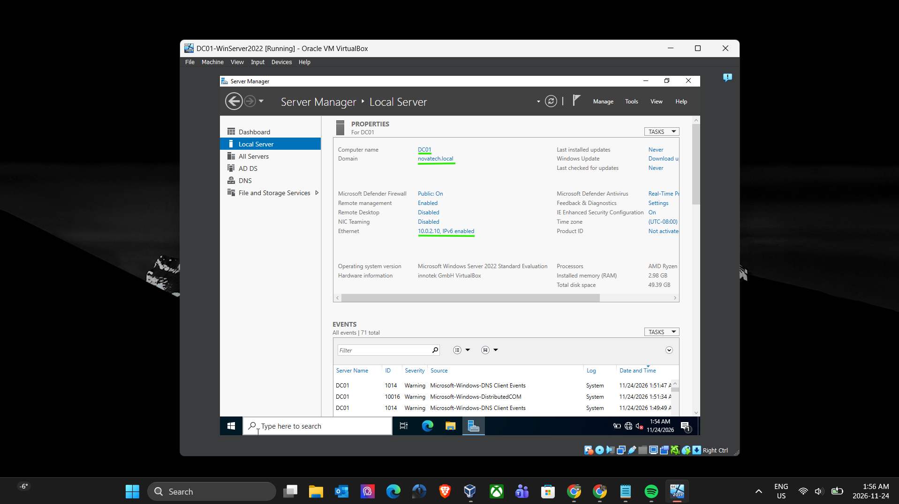
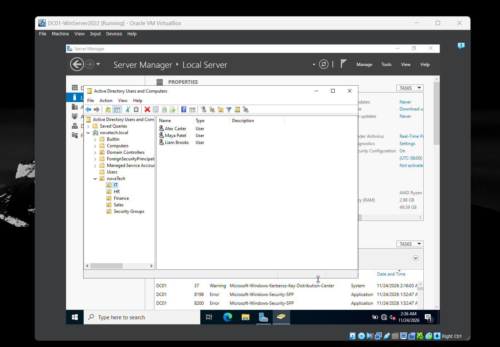
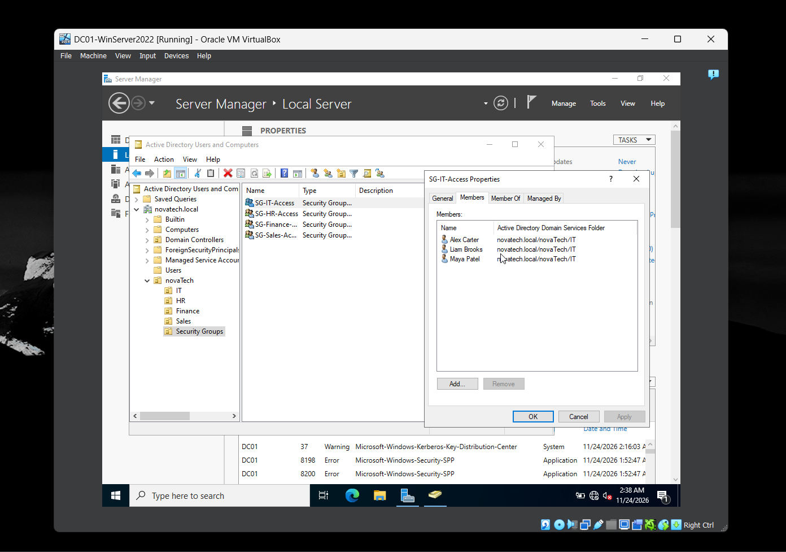
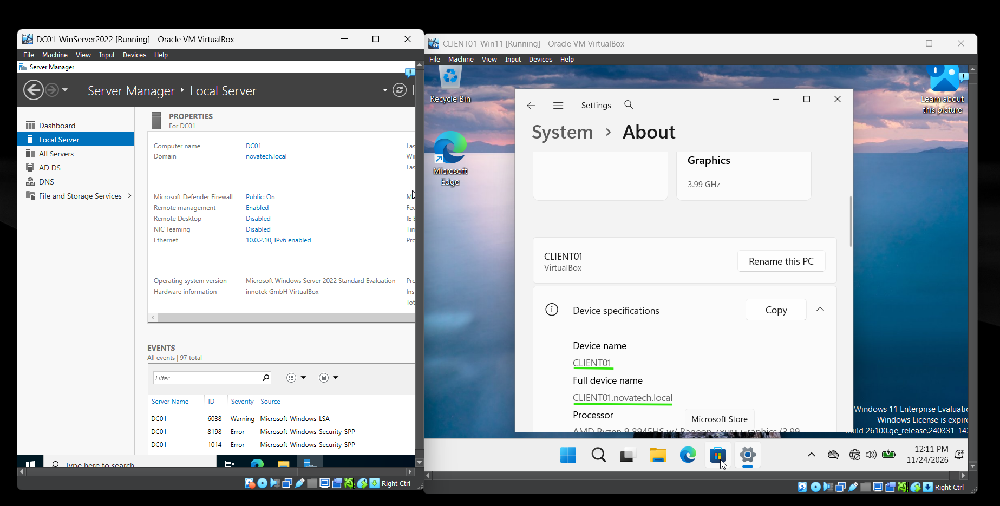
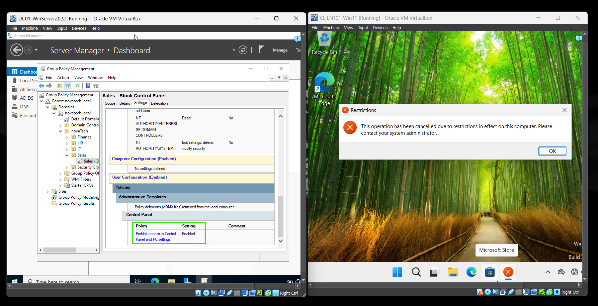
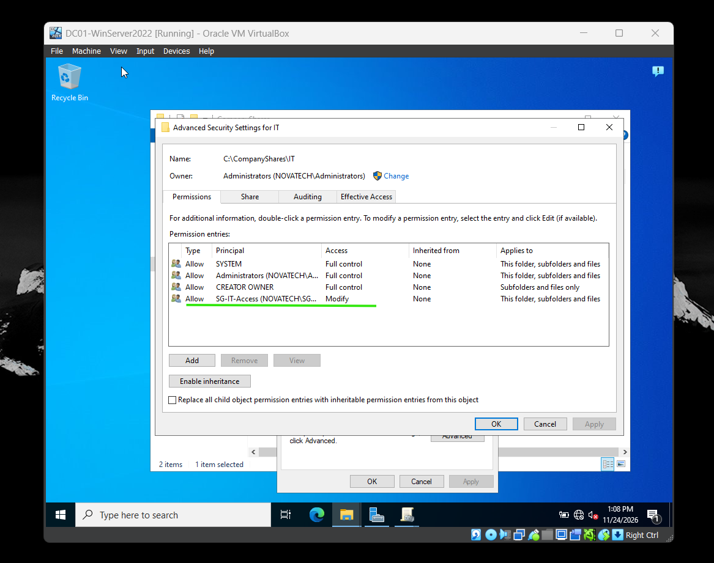

# Windows Server & Active Directory — Corporate IT Environment

## 1. Project Overview
This lab simulates an on-premises corporate IT environment for a fictional company (**NovaTech**, domain `novatech.local`) with 12+ employees across four departments. The goal is to demonstrate foundational Level 1 Help Desk and Junior Systems Administrator skills, including Active Directory administration, role-based access control (RBAC), Group Policy management, and real-world user support troubleshooting.

### Repository Structure
```text
windows-server-active-directory-lab/
├── README.md
├── screenshots/
├── setup-guide/
│   └── lab-setup-guide.md
└── troubleshooting-reports/
    ├── 01-new-user-onboarding.md
    ├── 02-password-reset.md
    ├── 03-account-lockout.md
    ├── 04-shared-folder-access.md
    └── 05-department-transfer.md
```

---

## 2. Lab Setup

| Component | Configuration |
|---|---|
| **Hypervisor** | Oracle VirtualBox |
| **Virtual Network** | VirtualBox NAT Network (`NatNetwork` — `10.0.2.0/24`) |
| **Domain Controller (`DC01`)** | Windows Server 2022 Standard Evaluation (Desktop Experience) — 4 GB RAM, 2 vCPUs, 50 GB Disk |
| **DC01 IP Configuration** | Static IP: `10.0.2.10` / Subnet: `255.255.255.0` / Gateway: `10.0.2.1` / DNS: `127.0.0.1` |
| **Client Workstation (`CLIENT01`)** | Windows 11 Enterprise Evaluation — 4 GB RAM, 2 vCPUs, 50 GB Disk |
| **CLIENT01 DNS Configuration** | Preferred DNS: `10.0.2.10` (pointed to `DC01`) |
| **Active Directory Domain** | `novatech.local` (NetBIOS: `NOVATECH`) |

> For the full step-by-step build walkthrough, see [setup-guide/lab-setup-guide.md](setup-guide/lab-setup-guide.md).

---

## 3. Implementation Summary

### Domain & Directory Structure
* Promoted `DC01` to a Domain Controller with **Active Directory Domain Services (AD DS)** and **DNS Server** roles.
* Created a top-level `NovaTech` Organizational Unit (OU) with child OUs for `IT`, `HR`, `Finance`, `Sales`, and `Security Groups`.
* Provisioned 12 employee accounts (3 per department) and assigned them to department-level Global Security Groups (`SG-IT-Access`, `SG-HR-Access`, `SG-Finance-Access`, `SG-Sales-Access`).

### Client Domain Join
* Configured `CLIENT01` to use `10.0.2.10` for DNS resolution and joined it to `novatech.local`.
* Verified domain authentication by signing in with standard domain user accounts.

### Shared Folders & NTFS Permissions
* Created department shares (`\\DC01\IT` and `\\DC01\HR`) under `C:\CompanyShares`.
* Disabled inheritance, removed default `NOVATECH\Users` access, and applied **Modify** NTFS permissions exclusively to the corresponding department Security Group.

### Group Policy Management
* Created and linked `Sales - Block Control Panel` to the `Sales` OU to prohibit access to Control Panel and PC Settings for non-IT staff.
* Configured an **Account Lockout Policy** (5 invalid logon attempts) in the `Default Domain Policy` to protect against brute-force login attempts.

---

## 4. Key Configuration Screenshots

| Configuration | Evidence |
|---|---|
| **Domain Controller Setup** |  |
| **OUs & User Accounts** |  |
| **Security Group Memberships** |  |
| **Client Domain Join** |  |
| **Group Policy Configuration** |  |
| **Shared Folder NTFS Permissions** |  |

---

## 5. Troubleshooting Scenarios
Five realistic Level 1 Help Desk tickets were simulated, investigated, resolved, and verified in this environment:

1. **[New Employee Onboarding](troubleshooting-reports/01-new-user-onboarding.md)** — Provisioning a new HR account (`dbrooks`), enforcing password change at first logon, and granting HR share access.
2. **[Password Reset](troubleshooting-reports/02-password-reset.md)** — Resetting a forgotten password for `sjenkins` and verifying forced password update on `CLIENT01`.
3. **[Account Lockout Investigation](troubleshooting-reports/03-account-lockout.md)** — Investigating a locked account (`mreed`) using Event Viewer (Event ID `4740`) and unlocking it in ADUC.
4. **[Shared Folder Access Denied](troubleshooting-reports/04-shared-folder-access.md)** — Diagnosing missing Security Group membership for `mpatel` and refreshing her logon token to restore `\\DC01\IT` access.
5. **[Department Transfer](troubleshooting-reports/05-department-transfer.md)** — Moving `jvance` from `Sales` to `IT`, updating Security Group memberships, and verifying GPO removal and new share access.

---

## 6. What I Learned
* **DNS is the backbone of Active Directory:** Client machines cannot locate or join a domain unless their DNS points directly to the Domain Controller.
* **Group-based permissions scale:** Assigning NTFS permissions to Security Groups instead of individual users makes onboarding, troubleshooting, and department transfers fast and error-free.
* **Security tokens require re-authentication:** Adding a user to a Security Group does not grant immediate folder access until the user signs out and signs back in to refresh their Kerberos ticket.
* **Auditing and GPO verification:** Using Event Viewer (`Event ID 4740`) and `gpupdate /force` provides concrete proof of root causes and policy updates.
