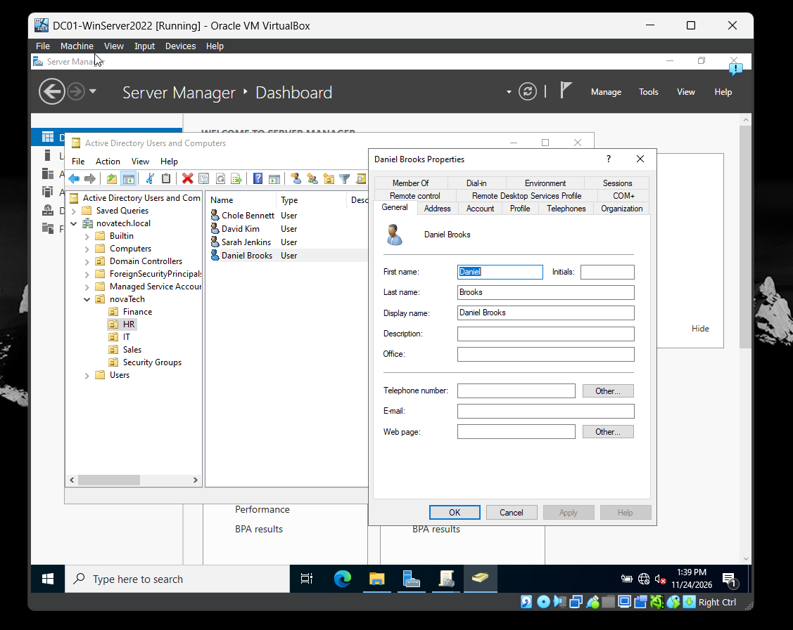

# Troubleshooting Report #01 — New Employee Onboarding

**Status:** Resolved  
**Issue:** A new HR coordinator (Daniel Brooks) requires a domain account and access to the HR shared folder.

## 1. Reported Problem

HR submitted an onboarding request for a new employee, Daniel Brooks, who needs to sign in to a company workstation and access department files at `\\DC01\HR`.

## 2. Initial Investigation

- Verified the employee's department (`HR`) and required resource access (`\\DC01\HR`).
- Checked existing naming conventions in Active Directory (`first initial + last name` → `dbrooks`).
- Confirmed that `\\DC01\HR` permissions are managed via the `SG-HR-Access` Security Group.

## 3. Findings

No existing account existed for Daniel Brooks in the `HR` OU. Standard onboarding requires creating the user in the correct OU, enforcing a password change on first logon, and adding the user to the department Security Group.

## 4. Resolution

1. Opened **Active Directory Users and Computers (ADUC)** on `DC01` and navigated to `NovaTech > HR`.
2. Created a new user account for **Daniel Brooks** (`dbrooks`) with a temporary password and **User must change password at next logon** enabled.
3. Added `dbrooks` to the `SG-HR-Access` Security Group inside `NovaTech > Security Groups`.

## 5. Verification

- Signed in to `CLIENT01` as `dbrooks` using the temporary password.
- Confirmed Windows prompted for a mandatory password change at first logon.
- Opened File Explorer and navigated to `\\DC01\HR`, confirming full read/write access.

## 6. Tools Used

Active Directory Users and Computers (ADUC), File Explorer.

## 7. What I Learned

Following consistent naming conventions, placing users in the right OU from day one, and enforcing password changes at first logon keeps Active Directory secure and maintainable.
