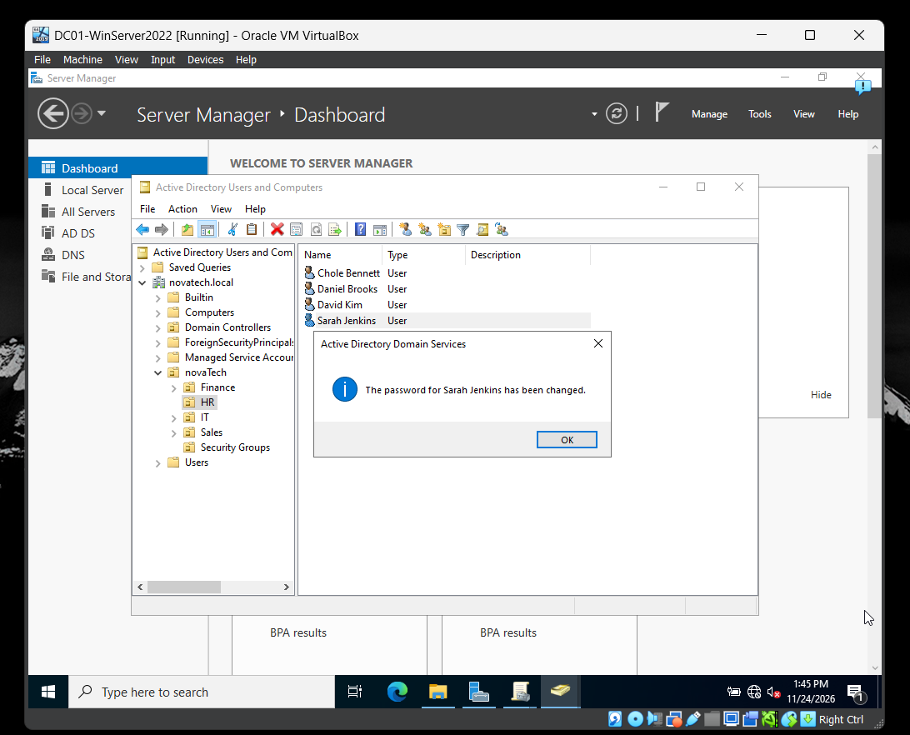

# Troubleshooting Report #02 — Employee Forgot Password

**Status:** Resolved  
**Issue:** User `sjenkins` (Sarah Jenkins, HR) cannot sign in because she forgot her password.

## 1. Reported Problem

Sarah Jenkins reported that her credentials are being rejected at the Windows 11 login screen and she cannot remember her current password.

## 2. Initial Investigation

- Located `sjenkins` in **Active Directory Users and Computers (ADUC)** under `NovaTech > HR`.
- Checked the **Account** tab to confirm the account was enabled and not expired or locked out.

## 3. Findings

The account was active and unlocked; the issue was simply a forgotten password requiring an administrative reset.

## 4. Resolution

1. Right-clicked **Sarah Jenkins** (`sjenkins`) in ADUC and selected **Reset Password...**.
2. Assigned a compliant temporary password.
3. Checked **User must change password at next logon** so the user immediately sets a private password.

## 5. Verification

- Signed in to `CLIENT01` as `sjenkins` with the temporary password.
- Confirmed Windows prompted her to create a new password and successfully loaded her desktop.

## 6. Tools Used

Active Directory Users and Computers (ADUC).

## 7. What I Learned

Always check the **User must change password at next logon** box during a password reset so IT staff never retain knowledge of an employee's active password.
