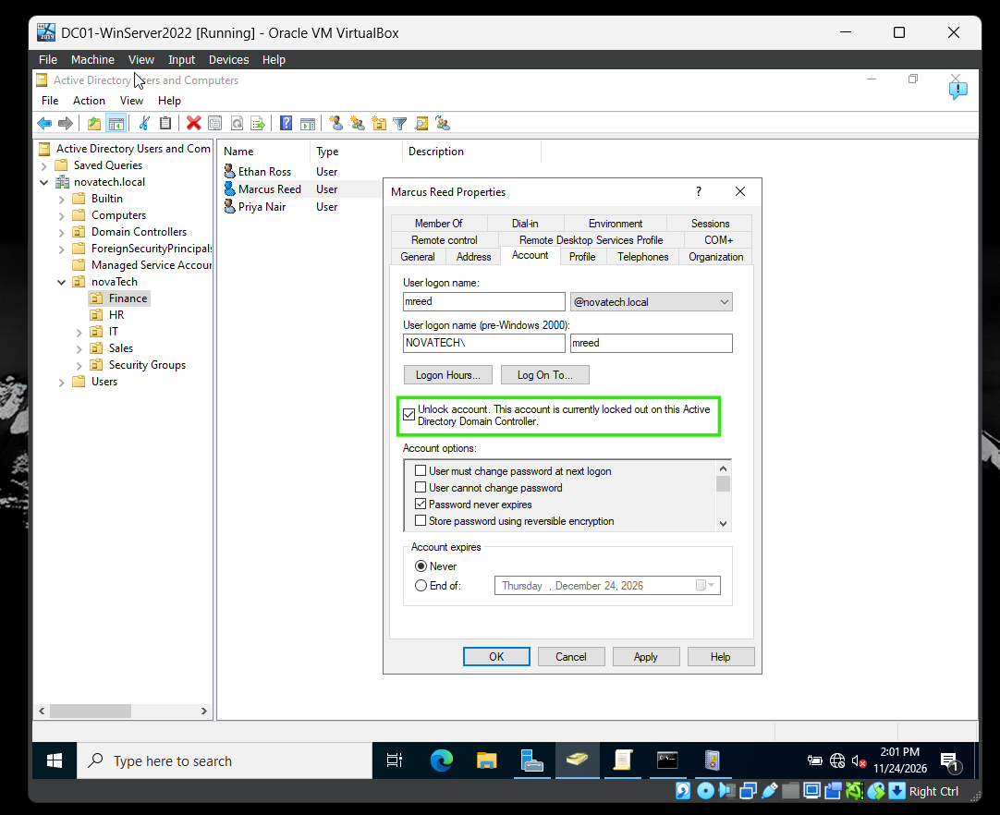

# Troubleshooting Report #03 — Employee Account Locked Out

**Status:** Resolved  
**Issue:** User `mreed` (Marcus Reed, Finance) is locked out of his domain account.

## 1. Reported Problem

Marcus Reed reported receiving the error _"The referenced account is currently locked out and may not be logged on to"_ when attempting to sign in to `CLIENT01`.

## 2. Initial Investigation

- Confirmed the domain's **Account Lockout Policy** in `Default Domain Policy` (threshold: 5 invalid logon attempts).
- Opened **Event Viewer > Windows Logs > Security** on `DC01` and filtered for **Event ID 4740** (A user account was locked out).
- Opened `mreed`'s properties in **ADUC** under `NovaTech > Finance` and inspected the **Account** tab.

## 3. Findings

Event ID `4740` confirmed that `mreed` was locked out due to 5 consecutive failed password attempts originating from `CLIENT01`. The **Unlock account** notice was active in ADUC.

## 4. Resolution

1. In ADUC, opened **Marcus Reed** (`mreed`) > **Account** tab.
2. Checked **Unlock account** and clicked **OK**.

## 5. Verification

- Signed in to `CLIENT01` as `mreed` using the correct password.
- Confirmed authentication succeeded without errors.

## 6. Tools Used

Active Directory Users and Computers (ADUC), Group Policy Management, Event Viewer (Event ID 4740).

## 7. What I Learned

Checking Event ID `4740` before unlocking an account helps identify _where_ the failed logins came from (e.g., a typo on a workstation vs. a cached old password on a mobile device or a brute-force attempt).
