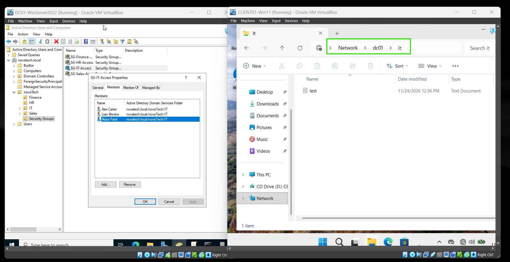

# Troubleshooting Report #04 — User Cannot Access Shared Folder

**Status:** Resolved  
**Issue:** User `mpatel` (Maya Patel, IT) receives "Access Denied" when opening `\\DC01\IT`.

## 1. Reported Problem

Maya Patel reported that she cannot open the IT department shared folder (`\\DC01\IT`) from `CLIENT01` and receives a Windows Network Error stating she does not have permission.

## 2. Initial Investigation

- Verified that `\\DC01\IT` was accessible to other IT users (confirming the share and network path were online).
- Checked NTFS Security permissions on `C:\CompanyShares\IT` on `DC01` and confirmed access is granted exclusively to `SG-IT-Access`.
- Inspected `mpatel`'s **Member Of** tab in **ADUC**.

## 3. Findings

`mpatel` was missing from the `SG-IT-Access` Security Group. Because `NOVATECH\Users` was removed from the folder's NTFS permissions, she was denied access.

## 4. Resolution

1. Opened **Maya Patel** (`mpatel`) in ADUC (`NovaTech > IT`).
2. Went to the **Member Of** tab, clicked **Add...**, and added `SG-IT-Access`.
3. Instructed the user to **sign out and sign back in** on `CLIENT01` so Windows would refresh her security group token.

## 5. Verification

- Signed out and signed back in as `mpatel` on `CLIENT01`.
- Navigated to `\\DC01\IT` in File Explorer and confirmed full read/write access was restored.

## 6. Tools Used

Active Directory Users and Computers (ADUC), File Explorer (NTFS Security Properties).

## 7. What I Learned

Updating a user's Security Group membership in Active Directory does not take effect immediately on an active session—the user must sign out and sign back in to receive an updated Kerberos access token.
