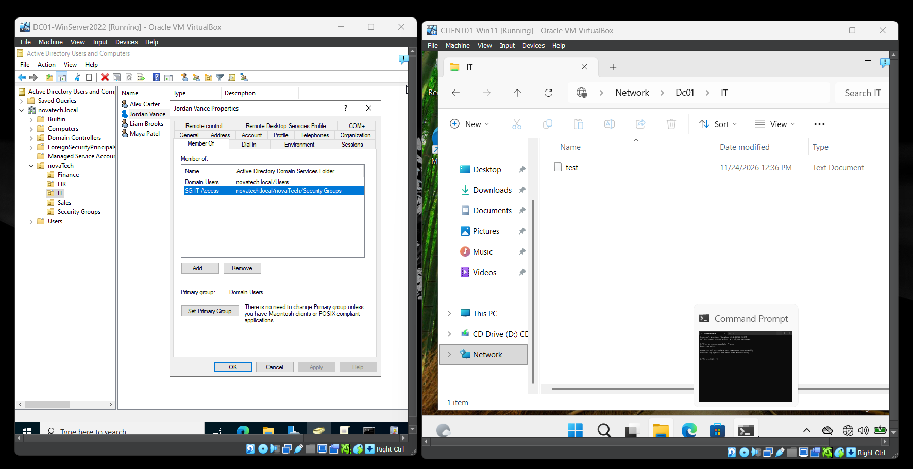

# Troubleshooting Report #05 — Employee Department Transfer

**Status:** Resolved  
**Issue:** User `jvance` (Jordan Vance) transferred from Sales to IT and needs updated permissions and policies.

## 1. Reported Problem

Jordan Vance moved from the Sales department to the IT department. He needs access to `\\DC01\IT`, should no longer have Sales access, and needs Control Panel restrictions lifted so he can perform IT duties.

## 2. Initial Investigation

- Located `jvance` in the `NovaTech > Sales` OU.
- Confirmed that `Sales - Block Control Panel` GPO is linked to the `Sales` OU.
- Checked `jvance`'s **Member Of** tab and confirmed membership in `SG-Sales-Access`.

## 3. Findings

To complete the transfer cleanly under the principle of least privilege, the user must be moved to the `IT` OU (to drop the Sales GPO) and have his Security Group memberships swapped.

## 4. Resolution

1. In **ADUC**, right-clicked **Jordan Vance** (`jvance`) in the `Sales` OU, selected **Move...**, and moved the account to the `IT` OU.
2. Opened `jvance`'s **Member Of** tab, removed `SG-Sales-Access`, and added `SG-IT-Access`.

## 5. Verification

- Signed in to `CLIENT01` as `jvance` and ran `gpupdate /force` in Command Prompt.
- Ran `control` via `Win + R` and confirmed **Control Panel** opened without restriction.
- Opened `\\DC01\IT` in File Explorer and confirmed read/write access.

## 6. Tools Used

Active Directory Users and Computers (ADUC), Group Policy Management, Command Prompt (`gpupdate /force`), File Explorer.

## 7. What I Learned

Moving a user between OUs automatically changes which Group Policies apply to them, while swapping Security Groups enforces the principle of least privilege by revoking old department access at the same time new access is granted.
